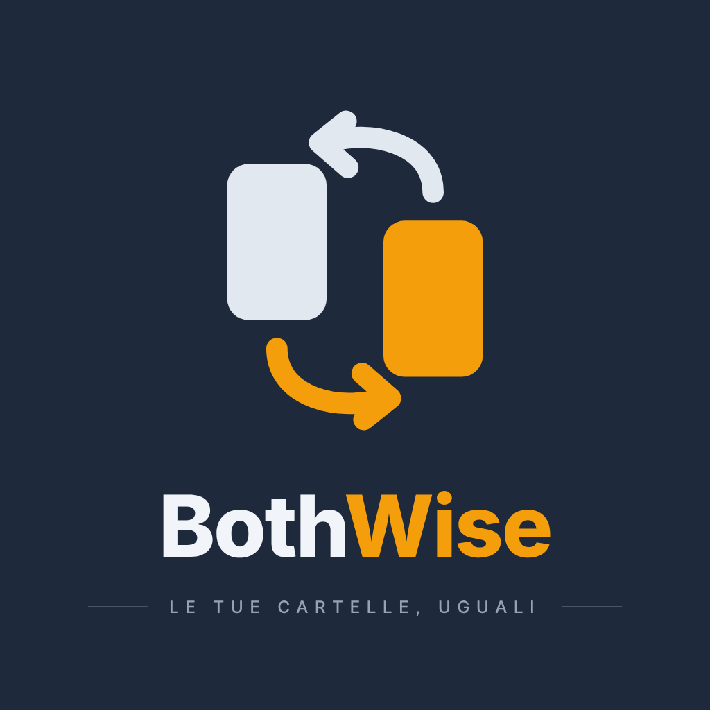
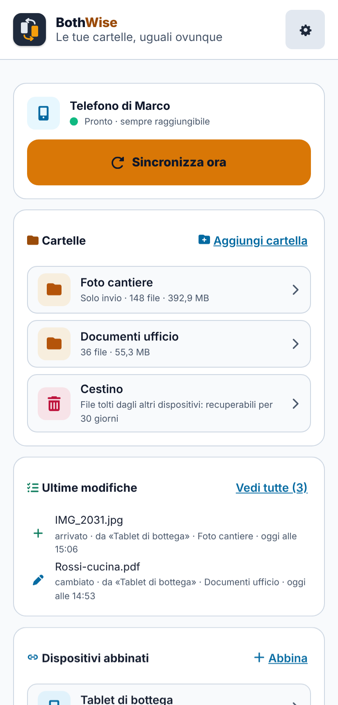
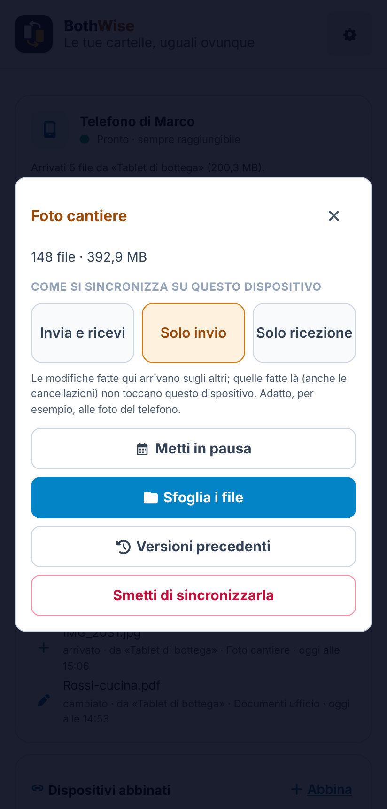
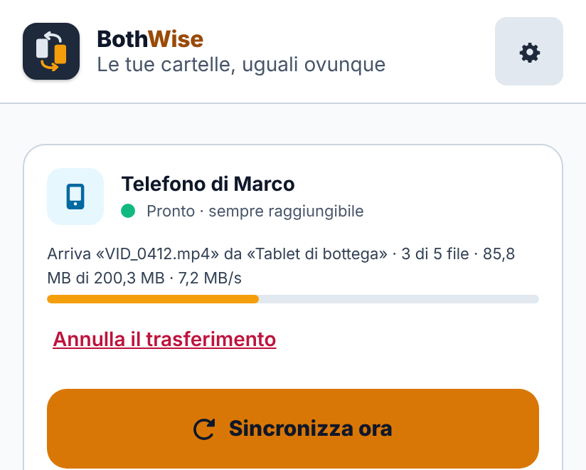
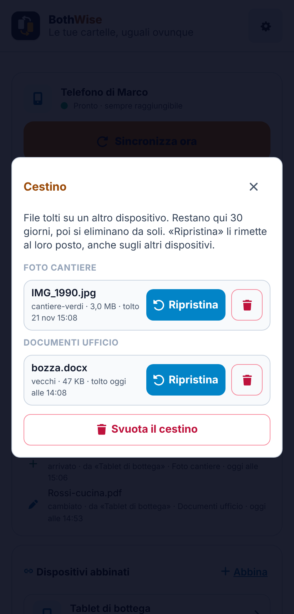
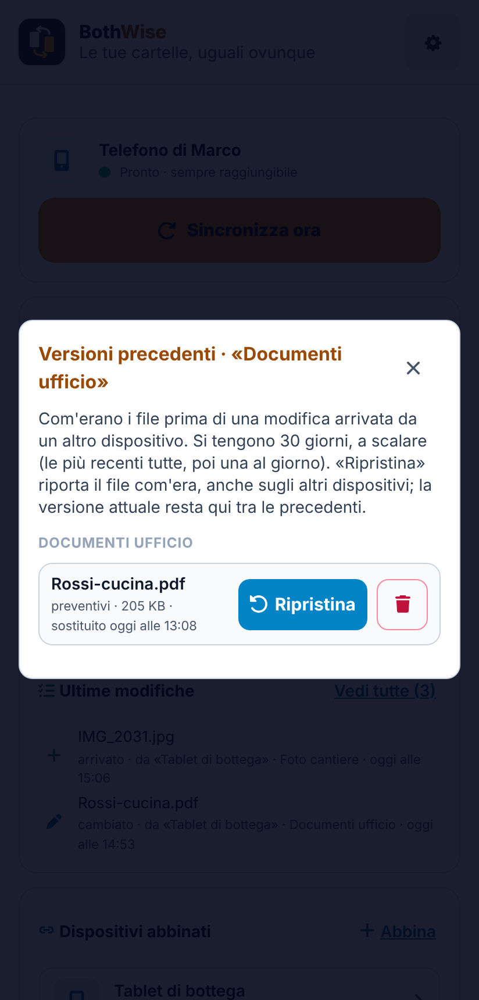
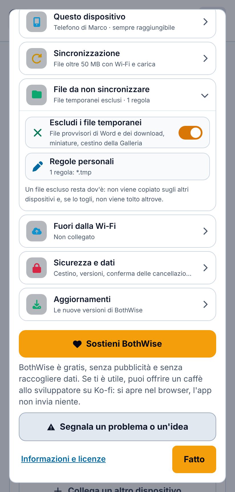
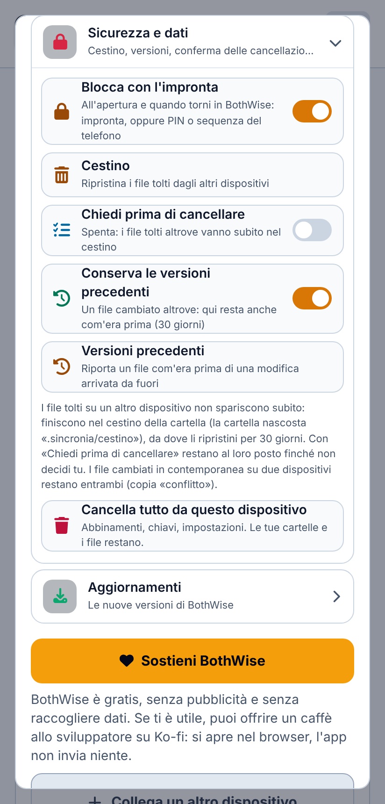
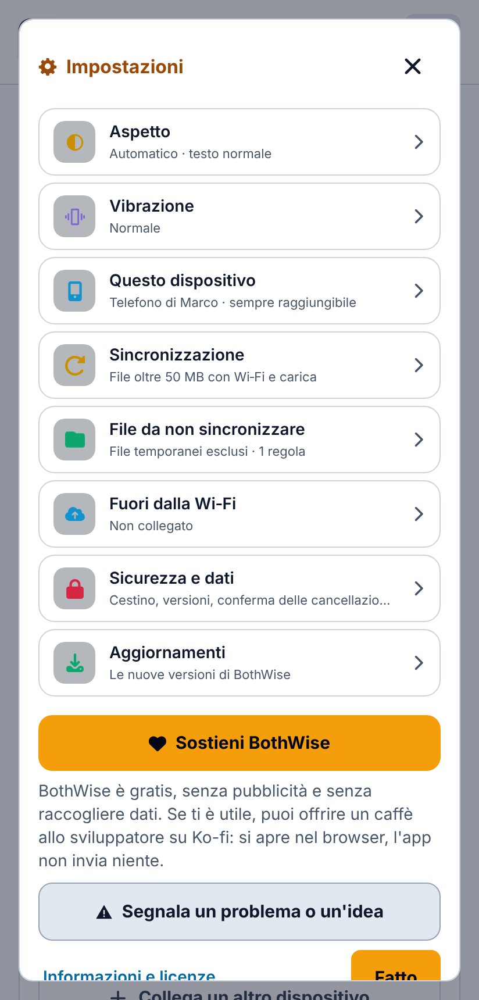
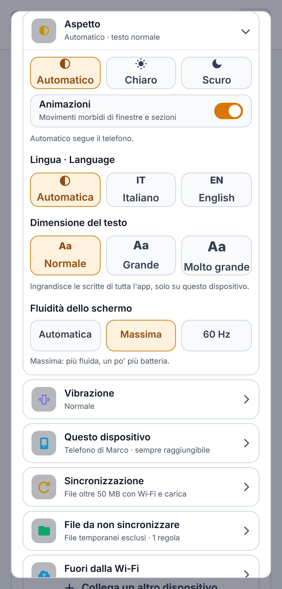

<p align="center">
  
</p>

<h1 align="center">BothWise</h1>
<p align="center"><b>Le tue cartelle, uguali ovunque.</b><br>
Senza cloud, senza account, senza server.</p>

<p align="center">Android 10+ · v0.9.2 · Italiano e English · Gratis e open source (GPL-3.0)</p>

---

## Installare

1. Apri la pagina **[Releases](../../releases/latest)** di questo repository da ogni telefono o tablet.
2. Scarica il file `BothWise-….apk` e aprilo. La prima volta Android chiede di permettere l'installazione dal browser o dall'app File.
3. Fatto. Le versioni successive arrivano da sole: BothWise controlla una volta a settimana se ce n'è una nuova (si può spegnere in Impostazioni → Aggiornamenti) e Android chiede sempre la conferma.

Si installa sopra la versione precedente senza perdere cartelle e abbinamenti. Serve **Android 10 o più recente**.

## Cos'è

BothWise tiene **identiche** le cartelle che scegli su più dispositivi che si trovano nella stessa rete Wi‑Fi. I file passano **direttamente da un dispositivo all'altro**, solo tra quelli che hai abbinato tu, con un collegamento cifrato. Nessuna registrazione, nessun server, nessuna pubblicità, nessun tracciamento.

Pensata per persone non tecniche: poche scelte chiare, testi in italiano semplice, e una regola che non si tocca: **mai perdere un file**.

<p align="center">
  
  &nbsp;
  
  &nbsp;
  
</p>

## Funzioni principali

### Collegare i dispositivi
- **Abbinamento in pochi secondi** con un codice o con un **QR**: un dispositivo lo mostra, l'altro lo inquadra.
- Con tre o più dispositivi basta abbinarne uno: gli altri si **presentano tra loro** da soli.
- **Sincronizzazione automatica**: quando una cartella cambia, BothWise se ne accorge e invia le modifiche. Opzione «Sempre raggiungibile» per restare in ascolto.
- Un dispositivo perso si **dimentica** da uno solo: gli altri lo sanno al primo incontro.

### Scegliere cosa sincronizzare
- Cartelle del telefono scelte con il selettore di Android, senza permessi «su tutto».
- **Cartelle pronte** con un tocco: *Foto della fotocamera*, *Documenti*, *Download*.
- **Condividi con BothWise** dal menù di Android: il file finisce nella cartella «Condivisi».
- Tre modi per ogni cartella: **invia e ricevi**, **solo invio**, **solo ricezione**.
- **File da non sincronizzare**: regole di serie (file temporanei e simili) e regole tue, una per riga.
- **Gestire i file dall'app**: sfogli le cartelle sincronizzate, apri i file con l'app giusta, li condividi, li rinomini, sposti ed elimini (nel cestino), aggiungi file o sottocartelle.
- **Ricevi file, come AirDrop**: un interruttore in Home e un tasto nella barra rapida di Android aprono la ricezione per 10 minuti, anche con l'app chiusa.
- **Un file a un solo dispositivo**: «Invia un file a un dispositivo» manda uno o più file solo a chi scegli, senza cartella; chi li riceve li salva dove vuole.

### Mai perdere file
- **Cestino**: i file tolti da un altro dispositivo non spariscono, si possono **ripristinare** (mai sovrascrivendo).
- **«Chiedi prima di cancellare»**: le cancellazioni arrivano come proposta da approvare.
- **Versioni precedenti**: ogni file cambiato altrove resta anche com'era, per 30 giorni.
- **Conflitti conservati e risolti dall'app**: se due dispositivi cambiano lo stesso file, restano entrambe le versioni; tu scegli «Tieni l'originale», «Tieni l'altra» o «Tieni entrambe», senza perdere niente.
- **Protezioni**: cartella vuota o senza permesso, cancellazioni o modifiche di massa improvvise, cartella spostata o scheda tolta, tutto viene fermato e ti viene chiesto cosa fare.

<p align="center">
  
  &nbsp;
  
  &nbsp;
  
</p>

### Sotto controllo
- **Avanzamento** in tempo reale (file e quantità) e **«Annulla il trasferimento»**.
- **Ultime modifiche** in Home, per cartella e dispositivo.
- **Pausa** di una cartella o di un dispositivo.
- **Quando sincronizzare**: sempre, al più una volta all'ora, oppure solo in certi giorni e orari.
- **Velocità massima** in invio (5, 2 o 1 MB al secondo) per non intasare la Wi‑Fi di casa.
- **Condizioni** per i file grandi: solo in Wi‑Fi e con il telefono in carica; **reti di fiducia**.
- **Spazio**: se manca, si liberano prima le versioni vecchie.
- Notifiche solo quando serve una tua decisione.

### Sicurezza e privacy
- Dispositivi riconosciuti per **identità crittografica**, collegamento **TLS 1.3**, file e nomi cifrati **AES‑256‑GCM**.
- **Blocco con impronta** (o PIN/sequenza), niente contenuto nelle app recenti.
- Nessun dato nelle copie di sicurezza di Android; **«Cancella tutto»** toglie abbinamenti, chiavi e impostazioni (i tuoi file restano).
- La pagina dell'app **non ha accesso alla rete**: la rete è usata solo dal motore nativo.
- Nessuna pubblicità, nessuna analitica di terzi.

<p align="center">
  
  &nbsp;
  
  &nbsp;
  
</p>

### Comodità
Italiano e English, tema chiaro/scuro, tre dimensioni del testo, animazioni e vibrazione regolabili, schermo a frequenza massima, segnalazione di un problema con le informazioni tecniche già pronte.

### Anche da lontano
**Fuori dalla Wi‑Fi**: una «cassetta delle lettere» cifrata sul **tuo** Google Drive o Dropbox, per sincronizzare anche quando i dispositivi non sono vicini. Il servizio vede solo dati cifrati, senza nomi né contenuti; su Google Drive BothWise chiede solo il permesso `drive.file` (vede solo i file che crea lei).

### Aggiornamenti
Una volta a settimana BothWise controlla su GitHub se c'è una versione nuova; si installa solo se è firmata come l'app che hai e se è proprio il file pubblicato.

## Come funziona
```
 Telefono  ⇄  Wi‑Fi (TLS 1.3, solo dispositivi abbinati)  ⇄  Tablet
     │                                                          │
  Cartelle (Storage Access Framework)             Cartelle (idem)
     └────────── motore PairWood: blocchi, versioni, cestino ─────┘
```
Il motore **PairWood** (di CrsLabs) divide i file in blocchi, invia solo ciò che è cambiato, riconosce spostamenti e conflitti e documenta il proprio protocollo.

## Documentazione
| Cosa | Dove |
|---|---|
| Guida all'uso con immagini (PDF) | [`guida/BothWise-Guida.pdf`](guida/BothWise-Guida.pdf) |
| Tutorial «come si fa» per ogni funzione (PDF) | [`guida/BothWise-Tutorial.pdf`](guida/BothWise-Tutorial.pdf) |
| Istruzioni per chi sviluppa | [`SVILUPPO.md`](SVILUPPO.md) |
| Informativa sulla privacy | [`PRIVACY.md`](PRIVACY.md) · [crslabs.github.io/privacy/bothwise.html](https://crslabs.github.io/privacy/bothwise.html) |

Guida e tutorial sono divisi nelle stesse sei parti (Per cominciare, Le cartelle, Sincronizzare, Non perdere file, Dispositivi e sicurezza, Aspetto e aiuto), con l'indice e i numeri di pagina.

## Compilare
```
npm install
python3 costruisci.py
npx cap sync android
cd android && ./gradlew assembleRelease
```
Per l'APK firmato serve la chiave di firma, che **non** è in questo repository: senza, Gradle produce un APK non firmato da provare in proprio. Dettagli in [`SVILUPPO.md`](SVILUPPO.md).

## Sostieni BothWise

BothWise è gratis, senza pubblicità e senza raccogliere dati. Se ti è utile puoi offrire un caffè: **[ko-fi.com/crslabs](https://ko-fi.com/crslabs)**.

## Contatti

Problemi, idee, domande: **crslabs.info@gmail.com**, oppure «Segnala un problema o un'idea» dentro l'app.

## Licenza

© 2026 CrsLabs. BothWise è software libero: puoi usarlo, studiarlo, modificarlo e ridistribuirlo secondo i termini della **GNU General Public License versione 3 o successiva** (testo completo in [`LICENSE`](LICENSE)). È distribuito nella speranza che sia utile, ma **senza alcuna garanzia**.

Componenti di terzi: [Capacitor](https://capacitorjs.com) (licenza MIT), icone Font Awesome Free (CC BY 4.0) in parte ridisegnate, e le altre elencate in «Informazioni e licenze» dentro l'app. Il motore di sincronizzazione PairWood è di CrsLabs e qui è incluso già compilato in `android/pairwood-sdk`.
