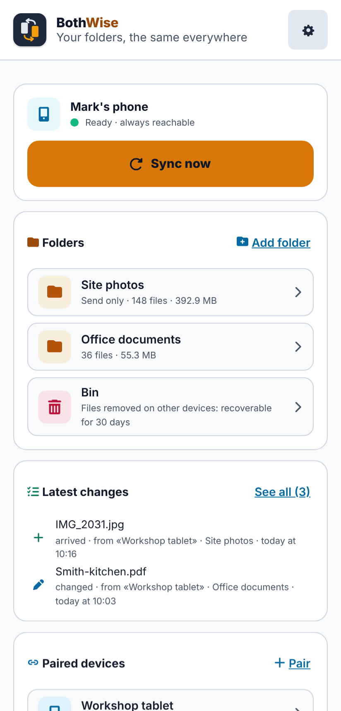
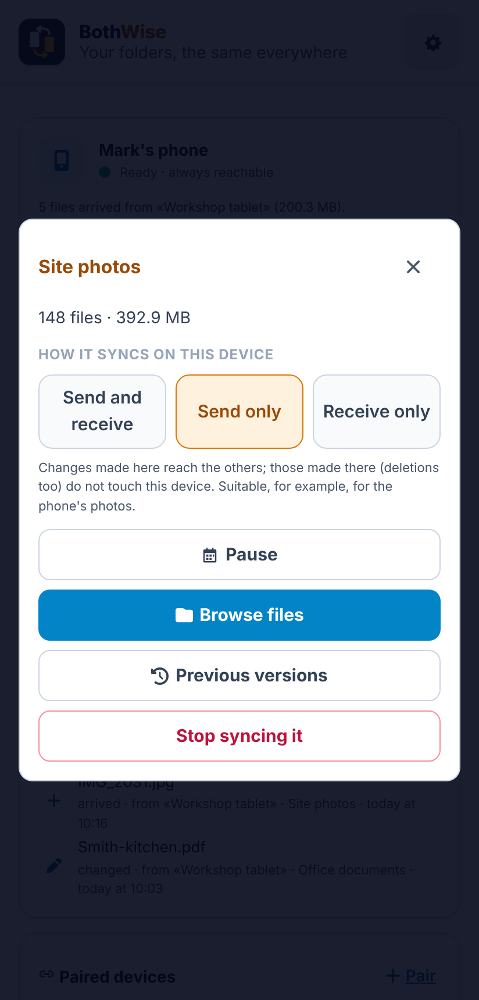
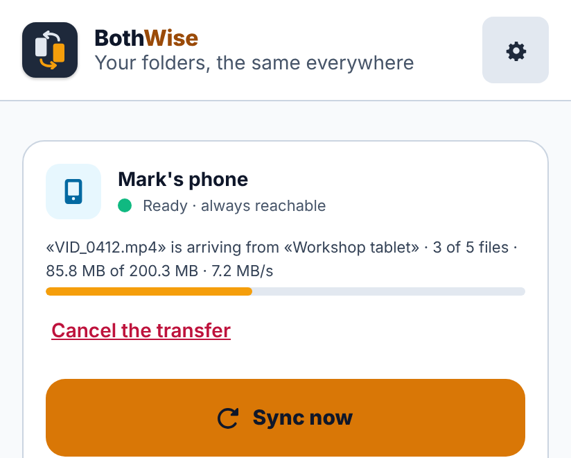
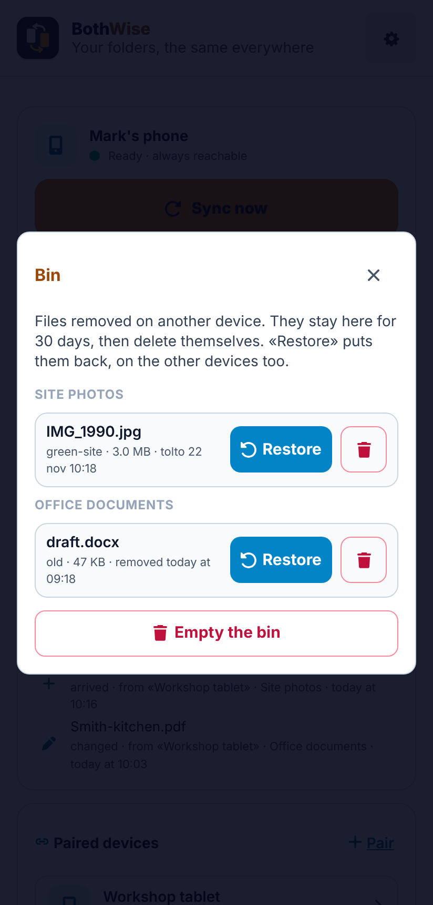
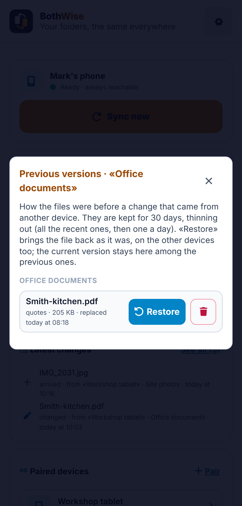
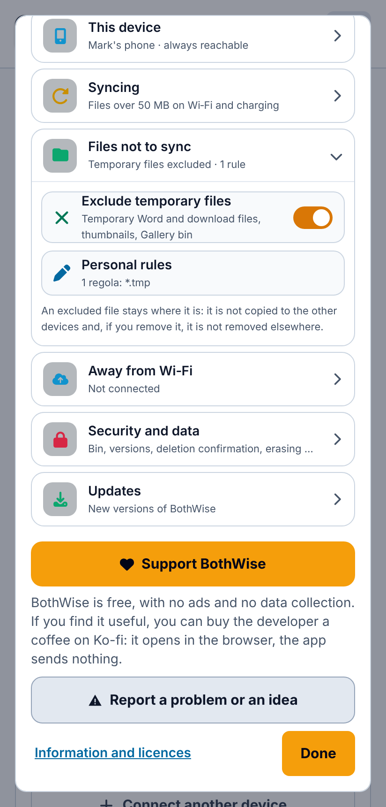
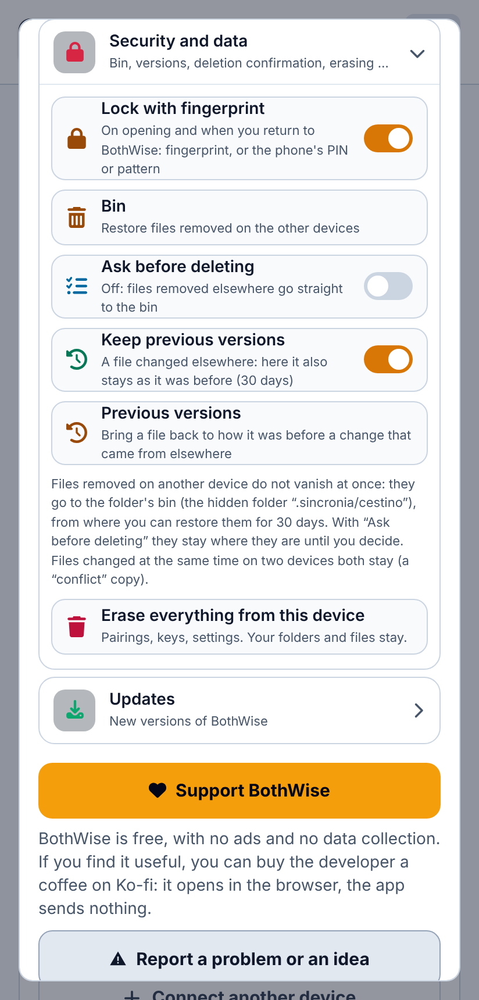
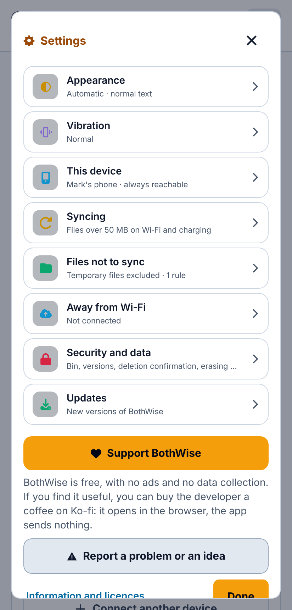
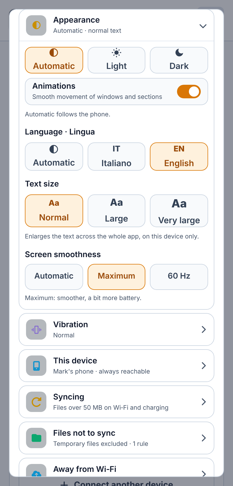

<p align="center">
  
</p>

<h1 align="center">BothWise</h1>
<p align="center"><b>Your folders, the same everywhere.</b><br>
No cloud, no account, no server.</p>

<p align="center">Android 10+ · v0.9.3 · English and Italian · Free and open source (GPL-3.0)</p>

---

## Install

1. Open the **[Releases](../../releases/latest)** page of this repository on each phone or tablet.
2. Download the `BothWise-….apk` file and open it. The first time, Android asks you to allow installs from the browser or the Files app.
3. Done. Later versions arrive by themselves: BothWise checks once a week for a new one (can be turned off in Settings → Updates) and Android always asks for confirmation.

It installs over the previous version without losing folders and pairings. It needs **Android 10 or later**.

## What it is

BothWise keeps the folders you choose **identical** on several devices on the same Wi‑Fi network. Files go **directly from one device to another**, only between those you paired yourself, over an encrypted connection. No sign‑up, no server, no ads, no tracking.

Made for non‑technical people: few clear choices, plain language, and one rule that never changes: **never lose a file**.

<p align="center">
  
  &nbsp;
  
  &nbsp;
  
</p>

## Features

### Connecting devices
- **Pairing in seconds** with a code or a **QR**: one device shows it, the other scans it.
- With three or more devices you only need to pair one: the others **introduce themselves** automatically.
- **Automatic sync**: when a folder changes, BothWise notices and sends the changes. «Always reachable» option to keep listening.
- A lost device is **forgotten** from just one of yours: the others learn it at the first meeting.

### Choosing what to sync
- Phone folders chosen with the Android picker, with no «everything» permissions.
- **Ready‑made folders** in one tap: *Camera photos*, *Documents*, *Download*.
- **Share with BothWise** from the Android menu: the file goes into the «Shared» folder.
- Three modes per folder: **send and receive**, **send only**, **receive only**.
- **Files not to sync**: built‑in rules (temporary files and the like) and your own rules, one per line.
- **Manage files in the app**: browse synced folders, open files with the right app, share, rename, move and delete them (into the bin), add files or subfolders.
- **Receive files, like AirDrop**: a switch on the Home and a button in the Android quick settings open reception for 10 minutes, even with the app closed.
- **A file to one device only**: «Send a file to a device» sends one or more files only to whoever you choose, without a folder; the receiver saves them where they like.

### Never lose files
- **Bin**: files removed by another device don't vanish, they can be **restored** (never overwriting).
- **«Ask before deleting»**: deletions arrive as a proposal to approve.
- **Previous versions**: every file changed elsewhere is also kept as it was, for 30 days.
- **Conflicts kept and resolved in the app**: if two devices change the same file, both versions stay; you choose «Keep the original», «Keep the other» or «Keep both», losing nothing.
- **Protections**: empty folder or lost permission, sudden mass deletions or changes, moved folder or removed card: everything is stopped and you're asked what to do.

<p align="center">
  
  &nbsp;
  
  &nbsp;
  
</p>

### Under control
- Live **progress** (files and amount) and **«Cancel the transfer»**.
- **Latest changes** on the Home, by folder and device.
- **Pause** a folder or a device.
- **When to sync**: always, at most once an hour, or only on certain days and hours.
- **Maximum sending speed** (5, 2 or 1 MB per second) so your home Wi‑Fi doesn't get clogged.
- **Conditions** for large files: only on Wi‑Fi and with the phone charging; **trusted networks**.
- **Space**: if it runs out, old versions are freed first.
- Notifications only when a decision of yours is needed.

### Away from Wi‑Fi
An encrypted «mailbox» on **your** Google Drive or Dropbox, to sync even when the devices aren't close. The service sees only encrypted data, with no names or contents; on Google Drive BothWise requests only the `drive.file` permission (it sees only the files it creates).

### Security and privacy
- Devices recognised by **cryptographic identity**, **TLS 1.3** connection, files and names encrypted with **AES‑256‑GCM**.
- **Fingerprint lock** (or PIN/pattern), no content in recent apps.
- No data in Android's backups; **«Erase everything»** removes pairings, keys and settings (your files stay).
- The app page **has no network access**: the network is used only by the native engine.
- No ads, no third‑party analytics.

<p align="center">
  
  &nbsp;
  
  &nbsp;
  
</p>

### Comfort
English and Italian, light/dark theme, three text sizes, animations, screen smoothness and vibration adjustable, problem reports with the technical information ready. **Updates** from GitHub once a week: an update installs only if it is signed like the app you have and is exactly the published file.

## How it works
```
 Phone  ⇄  Wi‑Fi (TLS 1.3, paired devices only)  ⇄  Tablet
   │                                                   │
 Folders (Storage Access Framework)          Folders (same)
   └───── PairWood engine: blocks, versions, bin ──────┘
```
The **PairWood** engine (by CrsLabs) splits files into blocks, sends only what changed, recognises moves and conflicts, and documents its own protocol.

## Documentation
| What | Where |
|---|---|
| User guide with screenshots (PDF) | [`guida/BothWise-Guide-EN.pdf`](guida/BothWise-Guide-EN.pdf) · Italian: [`guida/BothWise-Guida.pdf`](guida/BothWise-Guida.pdf) |
| «How to» tutorials (PDF) | [`guida/BothWise-Tutorials-EN.pdf`](guida/BothWise-Tutorials-EN.pdf) · Italian: [`guida/BothWise-Tutorial.pdf`](guida/BothWise-Tutorial.pdf) |
| Developer notes | [`DEVELOPMENT.md`](DEVELOPMENT.md) |
| Privacy policy | [`PRIVACY.md`](PRIVACY.md) · [crslabs.github.io/privacy/bothwise.html](https://crslabs.github.io/privacy/bothwise.html) |

The code and its comments are in Italian; folder names too (`guida` = guide, `prove` = tests, `lingua` = language, `rilasci` = releases, `icona` = icon).

## Build
```
npm install
python3 costruisci.py
npx cap sync android
cd android && ./gradlew assembleRelease
```
A signed APK needs the signing key, which is **not** in this repository: without it Gradle produces an unsigned APK for your own testing. Details in [`DEVELOPMENT.md`](DEVELOPMENT.md).

## Support BothWise

BothWise is free, with no ads and no data collection. If you find it useful you can buy me a coffee: **[ko-fi.com/crslabs](https://ko-fi.com/crslabs)**.

## Contact

Problems, ideas, questions: **crslabs.info@gmail.com**, or «Report a problem or an idea» inside the app.

## Licence

© 2026 CrsLabs. BothWise is free software: you can use, study, modify and redistribute it under the terms of the **GNU General Public License version 3 or later** (full text in [`LICENSE`](LICENSE)). It is distributed in the hope that it will be useful, but **without any warranty**.

Third-party components: [Capacitor](https://capacitorjs.com) (MIT licence), Font Awesome Free icons (CC BY 4.0) partly redrawn, and the others listed in «Information and licences» inside the app. The PairWood sync engine belongs to CrsLabs and is included here precompiled in `android/pairwood-sdk`.
